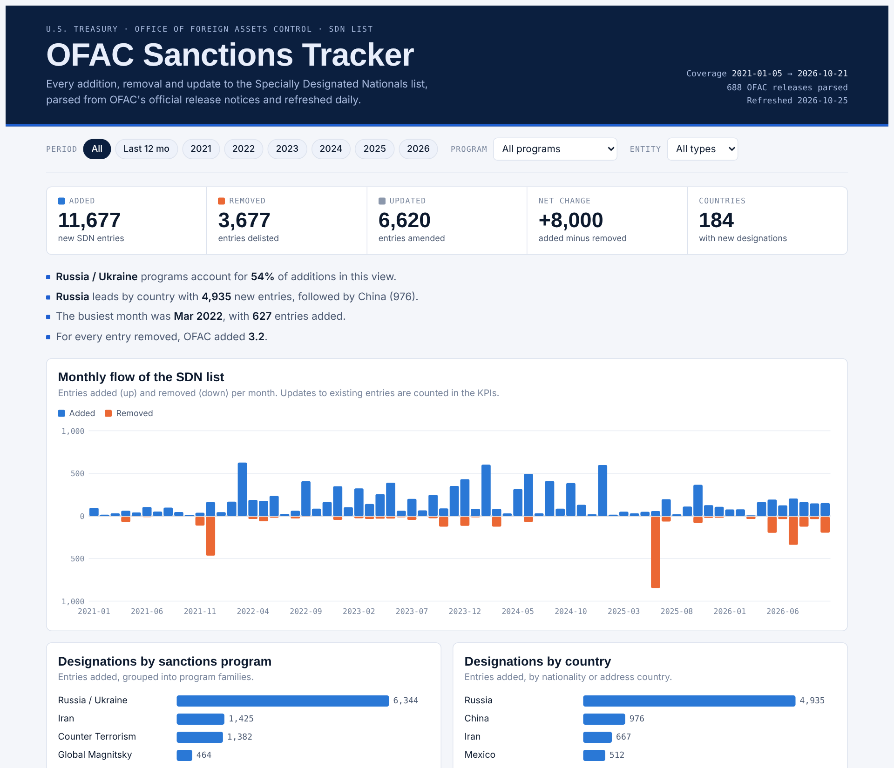

# OFAC Sanctions Tracker

**Every change to the U.S. Treasury SDN list since 2021, parsed, modeled and refreshed automatically.**

An end-to-end analytics project: Python ingestion → change parsing → SQLite star schema →
Power BI model + a public web dashboard, refreshed every day by GitHub Actions.

> 24,100 list changes · 688 official OFAC releases · Jan 2021 – Oct 2026
> 12,967 SDN additions · 4,006 removals · 6,751 updates



**Live dashboard:** `https://<your-user>.github.io/ofac-sanctions-tracker/` (GitHub Pages, `docs/` folder)
**New designations page:** `.../inclusions.html`: every SDN addition grouped by OFAC release, with aliases,
linked parties, the published entry text (last 120 days), filters and a one-click "Copy as table" for Excel/Outlook.

---

## Why this project

OFAC's Specially Designated Nationals (SDN) list is one of the most important reference lists
in banking compliance. OFAC publishes the *current* list, plus a notice for every update, but no
analytical history of how the list changes over time. This project builds that history:

- How many entries are added, removed or amended each month?
- Which sanctions programs drive the activity (Russia, Iran, counter-narcotics, terrorism…)?
- Which countries and entity types (individuals, companies, vessels, aircraft) are most affected?

## Architecture

```
OFAC Recent Actions (HTML notices) ─┐
                                    ├─► Python pipeline ─► SQLite star schema ─┬─► Power BI (CSV exports)
OFAC SDN.CSV / ADD.CSV (daily)  ────┘   parse + diff                         └─► docs/ web dashboard (GitHub Pages)
                      ▲
          GitHub Actions cron (daily 07:17 AST) commits refreshed data
```

| Layer | What it does | Code |
|---|---|---|
| Ingestion | Scrapes new "Sanctions List Updates" notices incrementally; downloads the official SDN.CSV/ADD.CSV snapshot | `src/ofac_tracker/sources.py` |
| Parsing | Turns each notice's free text into one record per affected entry: action, entity type, name, country, programs | `src/ofac_tracker/parse_actions.py` |
| Current lists | Reads the full SDN snapshot (SDN/ALT/ADD.CSV) and the UN consolidated XML; vessels excluded | `src/ofac_tracker/current_lists.py`, `overview.py` |
| Change detection | Diffs consecutive SDN snapshots by `ent_num` with attribute hashing (added / removed / updated + changed fields) | `src/ofac_tracker/snapshot_diff.py` |
| Modeling | Star schema: `fact_list_change`, `dim_action`, `dim_date`, `bridge_change_program`, view `v_monthly_net` | `sql/schema.sql`, `src/ofac_tracker/build.py` |
| Semantics | 60+ OFAC program tags grouped into readable program families | `src/ofac_tracker/programs.py` |
| BI | Power BI-ready CSVs + DAX measures; static web dashboard with filters, tooltips and a searchable change register | `data/powerbi/`, `powerbi/`, `docs/` |
| Automation | Daily scheduled workflow: tests → pipeline → commit | `.github/workflows/daily-refresh.yml` |

## Data model

```
dim_date ─┐
          ├─< fact_list_change >─ dim_action
          │         │
          │         └─< bridge_change_program (one row per program tag)
```

`fact_list_change` grain: **one SDN/Non-SDN entry affected by one OFAC release.**

## Run it locally

```bash
pip install -r requirements.txt
export PYTHONPATH=src

python -m ofac_tracker.pipeline            # fetch new data + rebuild everything
python -m ofac_tracker.pipeline --offline  # rebuild from data already in the repo
python -m pytest -q                        # unit tests
```

Outputs:

- `data/ofac_tracker.sqlite`: analytical database
- `data/powerbi/*.csv`: tables for Power BI
- `docs/index.html` + `docs/data.json`: web dashboard
- `docs/inclusions.html` + `docs/inclusions.json`: new designations page
- `docs/ofac.html`, `docs/onu.html`: list-status pages (Spanish) for OFAC SDN and the UN Security Council
  Consolidated List: last update, total records and aliases, Dominican nationals, latest additions and their
  aliases, type split, monthly trend and countries map. Vessels are excluded.
- `dist/ofac_dashboard.html`, `dist/ofac_new_designations.html`: self-contained pages (single file, data embedded)
- `data/snapshot_changes.csv`: day-over-day diff log from the official SDN snapshots

## Power BI

See [`powerbi/POWERBI_GUIDE.md`](powerbi/POWERBI_GUIDE.md) for the model relationships,
DAX measures and suggested report pages.

## Notes and limitations

- Counts follow OFAC's notices: when OFAC lists an entry once per alias, each line is counted.
- Country is taken from nationality/citizenship for individuals, flag for vessels, and the
  address country otherwise; about 9% of entries have no country.
- Program families are an analytical grouping made for this project, not an OFAC classification.

## Disclaimer

Independent portfolio project built only with public data from
[ofac.treasury.gov](https://ofac.treasury.gov/recent-actions/sanctions-list-updates).
**It is not a sanctions screening tool** and must not be used for compliance decisions.
Use OFAC's official [Sanctions List Search](https://sanctionssearch.ofac.treas.gov/) instead.
Not affiliated with, or built for, any employer.

---

Built by **Elvis Guzmán Rosario** · Data analysis · Power BI · SQL · Python · Process automation
